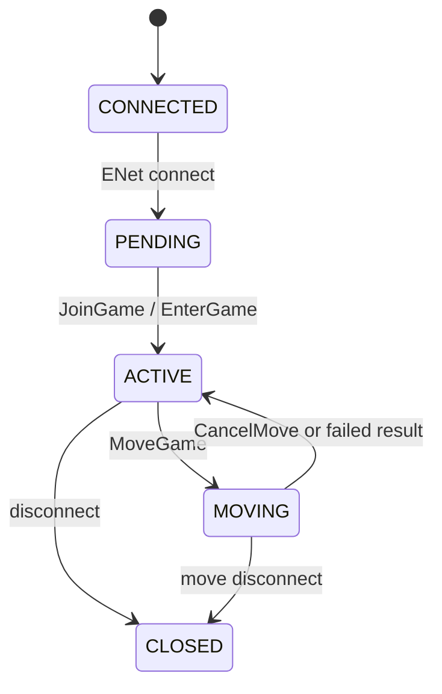

# XYSKY UDP

English | [中文](README_zh.md)

> [!IMPORTANT]
> **Sky client version compatibility** — 0.35.1 refers to the Sky client, not the server package or Node version.
>
> This branch targets the **0.35.1 `PlayerState` layout**. The field layout changes between
> Sky releases, and even builds of the same release do not always write the same field set:
> some clients emit the extra 8-byte field at `state+0x52B8`, some omit it. The node
> therefore identifies each player's layout at runtime and only accepts a variant that
> consumes the record exactly, so both 0.35.1 build variants are supported out of the box.
>
> **`room.player_state_decode`** (in `config.yml`) selects how deep the node parses:
>
> - `full` *(default)* — every field of the record: position, move, body frames, queued
>   pose, outfit, world quests, tail. Needed only if you want to inspect complete state.
> - `basic` — stops after `stateKind`, `position` and the `move` block (velocity). That is
>   all cross-room migration uses, it is roughly 20× cheaper, and it never touches the
>   records below the move block — the ones that change most between client builds. The
>   first frame of each player is still decoded in full to detect the layout, and later
>   frames take the cheap path.
>
> If a record cannot be matched to a known layout, the node keeps the player in the room and
> still reports its position (the first 12 bytes are fixed across all known revisions),
> logs one full sample per failing signature instead of one line per frame, and continues.
>
> **Mixing client versions is not supported.** Players on different Sky client versions
> cannot share a room; only players on the same version can see each other. For a client
> whose `PlayerState` revision differs, set `room.player_state_decode: basic`: it stops
> reading fields below the move block, so only the fixed header and the move block have to
> match.

**XYSKY UDP** is a multiplayer room server implementing the network protocol used by
*Sky: Children of the Light* (client 0.35.1). It is written in Node.js, uses
[ENet](https://www.npmjs.com/package/sky-enet) for reliable UDP game traffic, and optionally
exposes a separate Prometheus HTTP metrics listener (disabled by default).

One process hosts **one room** with up to **8 joined players**. It can run completely
standalone, or register itself with a **QWD** room manager so that many nodes form a
dynamically allocated, auto-balancing fleet.

> This is an independent community research / server implementation project. It is not
> affiliated with or endorsed by thatgamecompany. You are responsible for ensuring your use
> of client assets, network services, and deployment complies with applicable terms and law.

## Deployment modes

XYSKY UDP supports two modes, selected purely by whether `qwd.url` is set in `config.yml`.

### Standalone (default)

`qwd.url` is empty. The node does **not** connect to or register with any manager and simply
serves a single 8-player room at its public UDP address.

```text
XYSky (HTTP/WS backend)  ──direct UDP──▶  XYSKY UDP Node  ──▶  up to 8 players
```

In XYSky's own config, point `udp.uri` straight at this node's public UDP `IP:Port`.

### QWD-managed

`qwd.url` points at a QWD (Room Authority / Room Manager) WebSocket endpoint. On startup the
node connects over WebSocket and registers its `public_uri`. QWD then allocates rooms and
coordinates cross-room moves across all registered nodes.

```text
XYSky ──HTTP(S) /allocate──▶ QWD ──WebSocket──▶ XYSKY UDP Node ──public_uri──▶ Sky client
```

In this mode XYSky's `udp.uri` is the QWD **HTTP(S) `/allocate`** address, while the node's
`qwd.url` is the QWD **WebSocket** address — two different endpoints. See the companion
manager project ([README](https://github.com/that-sky-project/that-sky-xysky-udp-room-authority/blob/main/README.md)).

## Requirements

- Node.js 20 or newer
- npm
- A C/C++ build toolchain for the native `sky-enet` module (on Windows: Visual Studio Build
  Tools / Desktop C++ workload; on Linux: `build-essential` + Python 3)
- An available UDP port reachable by clients

## Executable releases with GitHub Actions

`.github/workflows/build.yml` builds only **Windows amd64** (`windows-2022`) and
**Linux amd64** (`ubuntu-22.04`) with pinned Node **22.23.5**. Trigger **Build executables**
manually or by pushing a `v*` tag. Archives are uploaded as Actions artifacts for 30 days;
no GitHub Release is created automatically.

Outputs: `xysky-udp-<version>-windows-amd64.zip` and
`xysky-udp-<version>-linux-amd64.tar.gz`, plus SHA256 files. Extract and run
`xysky-udp.exe` / `./xysky-udp`; the target machine does not need Node installed.
This is a **Node SEA executable with required sidecar resources**, not a zero-sidecar
single file. Keep the resource directory (native ENet addon and Pino workers) alongside
it. Configuration remains editable. Release configuration uses neutral standalone/
loopback defaults with metrics disabled, not the repository's private deployment address.
Linux requires glibc (built on Ubuntu 22.04), not Alpine/musl. Windows executables are unsigned.

```bash
./xysky-udp --host 0.0.0.0 --port 7777 --public-uri 203.0.113.10:5413
# Windows: .\xysky-udp.exe --host 0.0.0.0 --port 7777 --public-uri 203.0.113.10:5413
```

Local builds require **Node 22** (use **22.23.5** to match CI), Python 3 and a C/C++
toolchain. Windows SEA builds also require Windows SDK `signtool.exe`; the builder
finds it automatically, or accepts its path through `SIGNTOOL`:

```bash
npm ci --ignore-scripts
node node_modules/node-gyp/bin/node-gyp.js rebuild --directory=node_modules/sky-enet
npm run schema
npm run build:executable
npm run package:executable
```

esbuild/Pino's plugin bundle the application; postject injects SEA. Native resources
are built on the target platform. Archives are extracted again and their executable
is tested for help/version, ENet, metrics and JSON/pretty logging. Builds refuse to
overwrite a same-named output directory; preserve or move previous outputs first.

## Install and run

```bash
npm install
npm start
```

With the checked-in deployment `config.yml` the node listens on:

```text
ENet UDP: 0.0.0.0:19133
```

TCP and UDP may share the same port number. Development mode with auto-reload: `npm run dev`.

### Command-line options

Any flag passed on the command line overrides the same value in `config.yml`; flags you
omit keep the file value (or the built-in default).

```bash
node src/main.js \
  --config /etc/xysky/config.yml \
  --host 0.0.0.0 \
  --port 7777 \
  --public-uri 203.0.113.10:5413 \
  --qwd-url wss://your-qwd-host
```

| Flag | Meaning |
| --- | --- |
| `--config <PATH>` | YAML path (default: `./config.yml`); debug.yml is adjacent |
| `--host <HOST>` | ENet UDP bind hostname/IP |
| `--port <PORT>` | ENet UDP port, 1-65535 |
| `--public-uri <URI>` | Advertised `host:port` or `udp://host:port` |
| `--qwd-url <URL>` | `ws://` / `wss://` manager URL; `--qwd-url=` runs standalone |
| `--log-level <LEVEL>` | fatal / error / warn / info / debug / trace / silent |
| `--pretty`, `--no-pretty` | Enable human-readable logs / structured JSON |
| `--max-peers <COUNT>` | ENet connection slots, 1-4095 |
| `--channels <COUNT>` | ENet channels, 1-255 |
| `--tick-rate <HZ>` | Synchronization ticks/sec, 1-1000 |
| `--max-packet-bytes <BYTES>` | Accepted client packet bytes, 1-33554432 |
| `--bad-packet-limit <COUNT>` | Malformed-packet limit, 1-1000000 |
| `--move-timeout-ms <MS>` | Stuck-MOVING timeout, 1-2147483647 ms |
| `--player-state-decode <MODE>` | full / basic |
| `--metrics`, `--no-metrics` | Enable / disable Prometheus HTTP listener |
| `--metrics-host <HOST>` | Prometheus HTTP bind hostname/IP |
| `--metrics-port <PORT>` | Prometheus TCP port, 1-65535 |
| `-h`, `--help` | Generated help; exits normally without starting services |
| `-v`, `--version` | Package version; exits normally without starting services |

Commander handles help, version, unknown flags, missing values and rejected positional
arguments. Both `--port=7777` and `--port 7777` work. String fields (including numeric-looking
hostnames and config paths) remain strings; numeric values go through the shared schema.
Omitted boolean flags do not override the YAML file.

## Configuration

Explicit CLI overrides take precedence over YAML values, which take precedence over
schema defaults. No application environment-variable overrides are read. Without
`--config`, the main file is `./config.yml` relative to the current working directory;
a missing file is an error. Relative paths are resolved to an absolute source path.
`debug.yml` is optional and is loaded beside the selected configuration file.

`src/config/schema.js` exports the reusable **Zod v4** `configSchema` and
`debugFileSchema`. Unknown configuration keys, null/empty YAML documents and quoted
numbers/booleans fail validation; `{}` requests all defaults. YAML errors include the
source path and line/column; schema errors include field paths. Unknown debug switch
names warn and are ignored, but switch values must be booleans and top-level keys are strict.

Run `npm run schema` after schema changes to regenerate `config.schema.json` and
`debug.schema.json`. YAML editors can use `# yaml-language-server: $schema=./config.schema.json`
or `# yaml-language-server: $schema=./debug.schema.json`. Defaults, bounds and descriptions
come from the source schema; complex URL constraints remain authoritative at runtime.

The configuration reference below lists **schema defaults**, not deployment values.
The checked-in deployment uses port **19133**, channels **1**, and public address
**192.168.11.4:19133** instead. Pretty logs are enabled by default in both cases.
No configuration field stores the mutable runtime room identity.

| YAML key | Default | CLI / validation |
| --- | --- | --- |
| `logging.level` | `info` | `--log-level`: fatal/error/warn/info/debug/trace/silent |
| `logging.pretty` | `true` | `--pretty` / `--no-pretty` |
| `room.host` | `0.0.0.0` | `--host`: bind hostname/IP |
| `room.port` | `19132` | `--port`: integer 1–65535 |
| `room.public_uri` | `127.0.0.1:19132` | `--public-uri`: client-reachable UDP endpoint |
| `room.max_peers` | `64` | `--max-peers`: integer 1–4095; joined players remain capped at 8 |
| `room.channels` | `2` | `--channels`: integer 1–255 |
| `room.tick_rate` | `10` | `--tick-rate`: integer 1–1000 |
| `room.max_packet_bytes` | `16384` | `--max-packet-bytes`: integer 1–33554432 |
| `room.bad_packet_limit` | `8` | `--bad-packet-limit`: integer 1–1000000 |
| `room.move_timeout_ms` | `20000` | `--move-timeout-ms`: integer 1–2147483647 |
| `room.player_state_decode` | `full` | `--player-state-decode`: full/basic |
| `qwd.url` | `""` | `--qwd-url`: empty, ws:// or wss:// |
| `metrics.enabled` | `false` | `--metrics` / `--no-metrics` |
| `metrics.host` | `127.0.0.1` | `--metrics-host`: HTTP bind hostname/IP |
| `metrics.port` | `9100` | `--metrics-port`: integer 1–65535 |

### `room.public_uri`

The bind endpoint and advertised endpoint are independent: `--port` never rewrites
`public_uri`. Public endpoints accept `host:port`, `udp://host:port` and bracketed IPv6,
but reject credentials, paths, queries and fragments. Advertise an endpoint clients can
reach, not `0.0.0.0`. QWD URLs accept ws:// or wss://, reject credentials/fragments, and
allow paths/queries. Use `--qwd-url=` to override a configured manager and run standalone.

### Enabling / disabling QWD

- **Standalone:** leave `qwd.url: ""`. No manager connection or room registration occurs.
- **QWD-managed:** set `qwd.url: "wss://your-qwd-host"`. The node connects on startup, retries
  automatically on disconnect, and registers its `public_uri`.

### Prometheus and application lifecycle

Prometheus is disabled by default. Enable `metrics: { enabled: true, host: 127.0.0.1,
port: 9100 }`, or use `--metrics --metrics-host 127.0.0.1 --metrics-port 9100`.
Only `GET /metrics` is served with the registry's Prometheus content type; other
requests return 404. There is no separate HTTP status API and no authentication, so use
a trusted scraping network. The registry is isolated per application.

`main.js` loads configuration and logging, then `runtime/composition.js` explicitly
constructs services. `RoomServer` coordinates a single-use lifecycle; room identity,
telemetry, reservations and migration rosters have separate owners. ENet listens before
QWD registration. `reconnecting-websocket` owns backoff/reconnect and a public `ws`
adapter handles native send callbacks and heartbeat. `processLifecycle.js` stops
registered resources in reverse order, reports cleanup failures and flushes logging;
a 10-second deadline or second signal forces exit. Async commands are drained
before state cleanup, and the native listen loop ends before host destruction.

Packet handlers, codecs and feature services remain separate from main-program lifecycle
wiring. Only ordinary room allocation, migration and game synchronization are constructed.
Use `npm test`, `npm run check` and `npm run schema` for verification.


## Connection state machine



## License

[GNU Affero General Public License v3.0](LICENSE).
