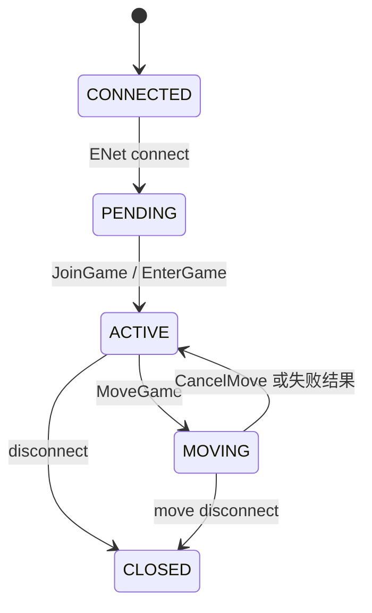

# XYSKY UDP

[English](README.md) | 中文

> [!IMPORTANT]
> **Sky 客户端版本兼容性**
>
> 本分支适配 **0.35.1 的 `PlayerState` 布局**。该布局会随 Sky 版本变化，而且即使是同一个版本，
> 不同客户端构建写出的字段集也不完全一样：有些客户端会写 `state+0x52B8` 处的 8 字节字段，
> 有些则整个省略。因此节点会在运行时识别每个玩家的布局，并且只接受「恰好消费完整条记录」的
> 变体，两种 0.35.1 构建都能直接使用。
>
> **`room.player_state_decode`**（位于 `config.yml`）决定解析深度：
>
> - `full`（默认）—— 解析记录的全部字段：位置、移动、身体帧、排队姿态、外观、世界任务、尾部。
>   只有需要查看完整状态时才需要它。
> - `basic` —— 只解析到 `stateKind`、`position` 和 `move` 块（速度）为止。跨房间迁移（串线）只用
>   这三个，CPU 开销约为全量解析的 1/20，而且完全不触碰 move 块之后的记录 —— 也就是不同客户端
>   构建之间最容易变化的部分。每个玩家的第一帧仍会做一次全量解析以识别布局，之后走精简路径。
>
> 若某条记录无法匹配任何已知布局，节点不会踢掉玩家：位置仍照常上报（前 12 字节在所有已知版本中
> 都不变），每种失败特征只完整输出一次样本（而不是每帧一条日志），然后继续运行。
>
> **不支持不同版本混连。**不同 Sky 客户端版本无法加入同一房间；只有版本相同的玩家才能看到彼此。
> 若客户端使用其它 `PlayerState` 版本，把 `room.player_state_decode` 设为 `basic`：它不再读取
> move 块之后的字段，只需要固定头部和 move 块对得上。

**XYSKY UDP** 是面向《Sky: Children of the Light》（客户端 0.35.1）网络协议的多人房间服务端。
使用 Node.js 开发，基于 [ENet](https://www.npmjs.com/package/sky-enet) 提供可靠 UDP 游戏通信，
并对外暴露只读的 HTTP 状态接口与 Prometheus 指标。

单个进程托管**一个房间**，最多 **8 名已加入玩家**。它既可以完全独立运行，也可以向 **QWD**
房间管理器注册，让多个节点组成一个动态分配、自动均衡的集群。

> 本项目为独立的社区技术研究 / 服务端实现项目，与 thatgamecompany 无隶属或官方合作关系。
> 使用者应自行确认对客户端资源、网络服务与部署行为的使用符合适用条款和当地法律。

## 部署模式

XYSKY UDP 支持两种模式，完全由 `config.yml` 中 `qwd.url` 是否填写来决定。

### 独立模式（默认）

`qwd.url` 为空。节点**不会**连接或注册到任何管理器，只在自己的公网 UDP 地址上提供一个 8 人房间。

```text
XYSky（HTTP/WS 后端）  ──直连 UDP──▶  XYSKY UDP Node  ──▶  最多 8 名玩家
```

此模式下，XYSky 的 `udp.uri` 直接填写本节点的公网 UDP `IP:端口`。

### QWD 托管模式

`qwd.url` 指向 QWD（房间权威 / 房间管理器）的 WebSocket 地址。节点启动时通过 WebSocket 连接并
注册自己的 `public_uri`。随后由 QWD 负责房间分配，并在所有已注册节点之间协调跨房间迁移。

```text
XYSky ──HTTP(S) /allocate──▶ QWD ──WebSocket──▶ XYSKY UDP Node ──public_uri──▶ Sky 客户端
```

此模式下，XYSky 的 `udp.uri` 是 QWD 的 **HTTP(S) `/allocate`** 地址，而节点的 `qwd.url` 是
QWD 的 **WebSocket** 地址——两者是不同的端点。配套的管理器项目见 `qwd/`（[README](https://github.com/that-sky-project/that-sky-xysky-udp-room-authority/blob/main/README_zh.md)）。

## 环境要求

- Node.js 20 或更高版本
- npm
- 用于编译原生 `sky-enet` 模块的 C/C++ 工具链（Windows：Visual Studio 生成工具 / 桌面 C++ 工作负载；
  Linux：`build-essential` + Python 3）
- 一个客户端可访问的 UDP 端口

## GitHub Actions 可执行发行包

`.github/workflows/build.yml` 只构建 **Windows amd64**（windows-2022）与
**Linux amd64**（ubuntu-22.04），使用固定 Node 22.23.5，其他架构不会打包。
在 GitHub Actions 手动运行 **Build executables**，或推送 `v*` 标签即可触发。
仅上传 Actions artifacts（保留 30 天），不自动创建 Release。

产物：`xysky-udp-<版本>-windows-amd64.zip`、`xysky-udp-<版本>-linux-amd64.tar.gz`，
附 SHA256。解压后运行 `xysky-udp.exe` / `./xysky-udp`，目标机器不需要安装 Node。
这是 **Node SEA 可执行程序 + 必要资源**，不是零附属文件的单文件：请完整保留资源目录，
其中有 ENet 原生 addon 与 Pino worker；配置外置，可直接编辑。
发行配置默认 standalone/loopback、metrics 关闭，不使用仓库里的本机私网部署地址。
Linux 需要 glibc 环境（基于 Ubuntu 22.04 构建），不支持 Alpine/musl；Windows exe 未代码签名。

```bash
# 从解压目录执行；CLI 参数仍优先于配置
./xysky-udp --host 0.0.0.0 --port 7777 --public-uri 203.0.113.10:5413
# Windows: .\xysky-udp.exe --host 0.0.0.0 --port 7777 --public-uri 203.0.113.10:5413
```

本机构建需要 **Node 22.23.5、Python 3、C++ 工具链**：

```bash
npm ci --ignore-scripts
node node_modules/node-gyp/bin/node-gyp.js rebuild --directory=node_modules/sky-enet
npm run schema
npm run build:executable
npm run package:executable
```

使用 esbuild/Pino 插件打包，postject 注入 SEA；原生资源由目标平台本机编译。
归档后会重新解压并实际测试 exe 的帮助、版本、ENet、指标与 JSON/pretty 日志。
构建拒绝覆盖同名输出目录；重新构建前先保留或移走旧产物。

## 安装与启动

```bash
npm install
npm start
```

使用默认 `config.yml` 时，节点监听：

```text
ENet UDP: 0.0.0.0:19133
```

TCP 与 UDP 可以使用相同端口号。开发模式（自动重载）：`npm run dev`。

### 命令行参数

命令行上传入的任意参数都会覆盖 `config.yml` 中的同名配置；未传入的参数沿用文件值
（或内置默认值）。

```bash
node src/main.js \
  --config /etc/xysky/config.yml \
  --host 0.0.0.0 \
  --port 7777 \
  --public-uri 203.0.113.10:5413 \
  --qwd-url wss://你的-qwd-地址
```

| 参数 | 说明 |
| --- | --- |
| `--config <PATH>` | 加载的配置文件路径（默认 `./config.yml`） |
| `--host <HOST>` | 房间服务器的监听地址 |
| `--port <PORT>` | 房间服务器的 UDP 端口 |
| `--public-uri <URI>` | 上报给 QWD 的公网 UDP 端点（`host:port`） |
| `--qwd-url <URL>` | QWD 管理器的 WebSocket 地址，例如 `wss://...` |

`node src/main.js --help` 输出同样的参数列表。`debug.yml` 始终从所加载配置文件的
同目录查找。

## 配置说明

配置只来自 YAML 与显式 CLI 参数：**CLI > 所选文件 > schema 默认值**，不读取应用环境变量。
未指定 `--config` 时使用当前工作目录的 `./config.yml`；文件不存在会报错。
`debug.yml` 可选，始终从所选配置文件旁加载。Commander 负责参数解析、帮助、版本及错误提示；
支持 `--port=7777`、`-h/--help`、`-v/--version`。

完整定义位于 `src/config/schema.js`，使用 **Zod v4**，包含默认值、数值范围、枚举和字段说明。
未知配置键、null、空 YAML、字符串形式的数字/布尔值会报错；`{}` 表示全部使用默认值。
YAML 错误包含文件路径与行列，schema 错误包含字段路径。房间 ID 属于运行时，不再混入配置。
`config.schema.json` 与 `debug.schema.json` 由 `npm run schema` 生成，可用于 YAML 编辑器提示。
复杂 URL 约束仍由运行时 schema 权威校验。当前部署文件保留 19133 端口、channels=1、
192.168.11.4:19133 公告地址与 pretty=true；下表展示的是**内置默认值**。

| YAML 配置项 | 默认值 | CLI / 校验 |
| --- | --- | --- |
| `logging.level` | `info` | `--log-level`：fatal/error/warn/info/debug/trace/silent |
| `logging.pretty` | `true` | `--pretty` / `--no-pretty` |
| `room.host` | `0.0.0.0` | `--host`：监听 hostname/IP |
| `room.port` | `19132` | `--port`：整数 1–65535 |
| `room.public_uri` | `127.0.0.1:19132` | `--public-uri`：客户端可达 UDP 端点 |
| `room.max_peers` | `64` | `--max-peers`：1–4095；已加入玩家仍限制为 8 |
| `room.channels` | `2` | `--channels`：1–255 |
| `room.tick_rate` | `10` | `--tick-rate`：1–1000 |
| `room.max_packet_bytes` | `16384` | `--max-packet-bytes`：1–33554432 |
| `room.bad_packet_limit` | `8` | `--bad-packet-limit`：1–1000000 |
| `room.move_timeout_ms` | `20000` | `--move-timeout-ms`：1–2147483647 |
| `room.player_state_decode` | `full` | `--player-state-decode`：full/basic |
| `qwd.url` | `""` | `--qwd-url`：空字符串、ws:// 或 wss:// |
| `metrics.enabled` | `false` | `--metrics` / `--no-metrics` |
| `metrics.host` | `127.0.0.1` | `--metrics-host` |
| `metrics.port` | `9100` | `--metrics-port`：1–65535 |

监听端点与公告端点独立；`--port` 不会自动改写 `public_uri`。公告地址支持 host:port、
udp://host:port 和带方括号的 IPv6，不接受凭据、路径、查询或 fragment。不要公告 `0.0.0.0`。
`--qwd-url=` 可临时覆盖已配置的管理器、切回独立运行。所有未传入的 CLI 参数保留文件值。

### Prometheus 与应用生命周期

默认不会开放 HTTP 监听。开启 `metrics: { enabled: true, host: 127.0.0.1, port: 9100 }`
或传入 `--metrics` 后，只提供 `GET /metrics`，其余请求返回 404。端点无鉴权，只应绑定可信
抓取网络；每个应用拥有独立 Registry。

`main.js` 负责 CLI/config/logging，`runtime/composition.js` 显式装配服务，`RoomServer`
仅协调一次性生命周期。房间身份、遥测、预留槽位和迁移名单分别管理；ENet 监听成功后才注册 QWD。
重连/退避交给 reconnecting-websocket，公开 ws 适配器负责原生 send 回调和心跳。
`processLifecycle.js` 按逆序停止资源、记录清理失败并刷新日志；10 秒超时或第二次信号强制退出。
关闭时先停止调度并排空命令/tick 工作，再清理状态；原生监听循环结束后才销毁 ENet host。

本次不修改数据包处理器、codec 或 feature-service 实现。现有 Audience/Performance 双向依赖
仍保留一个显式构造期绑定。验证命令：`npm test`、`npm run check`、`npm run schema`。

## 连接状态机



## 许可证

[GNU Affero General Public License v3.0](LICENSE)。
